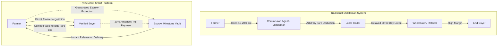
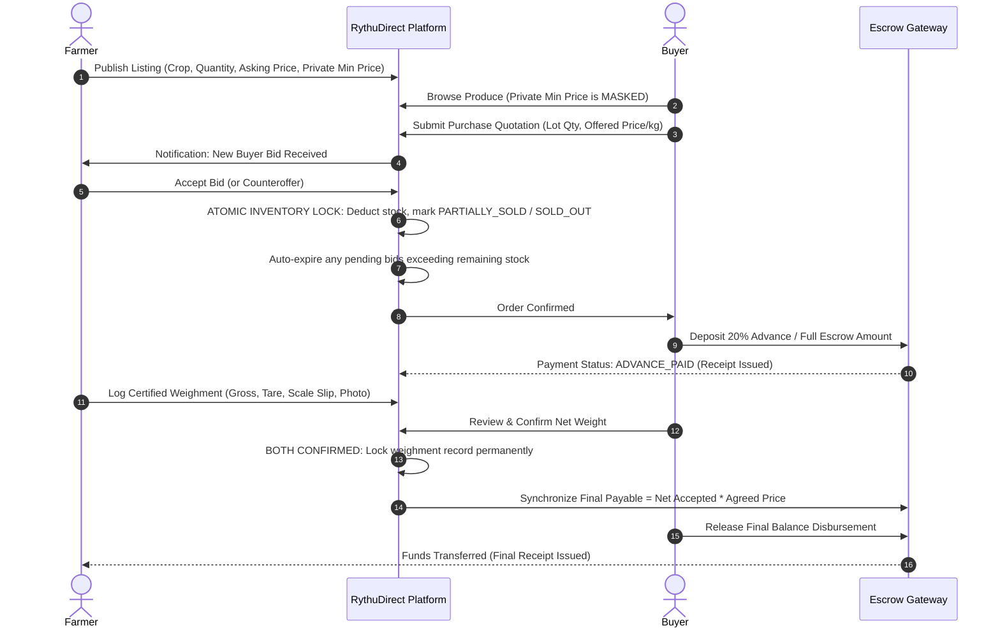
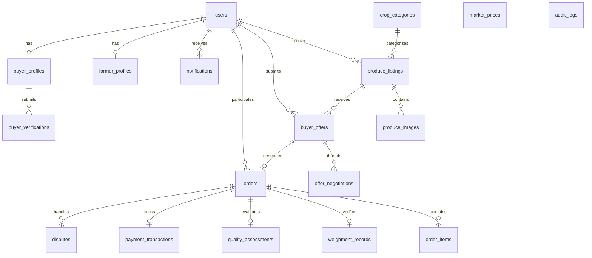

# RythuDirect: Comprehensive Platform & Presentation Guide

> **Tagline:** *"Fair Prices. Direct Buyers. Better Farming."*  
> **Platform Category:** B2B & B2C Smart Agricultural Marketplace  
> **Target Audience:** Farmers, Wholesalers, Retail Chains, Food Processors, HoReCa (Hotels/Restaurants), Institutional Buyers.

---

## 1. Executive Summary & Problem-Solution Matrix

In traditional agricultural supply chains across India (specifically in agricultural hubs like Telangana and Andhra Pradesh), smallholder and commercial farmers face systemic economic disadvantages. RythuDirect is engineered specifically to eliminate these inefficiencies through technology.

### The 8 Real-World Agricultural Problems Solved

| # | Real-World Agricultural Problem | How RythuDirect Solves It | Technical Implementation |
|---|---|---|---|
| **1** | **Low Farmer Bargaining Power** | Farmers define asking prices and hold a **confidential minimum acceptable price** that buyers cannot see. | Backend schema masking: `min_acceptable_price` is strictly stripped and set to `None` for all buyers. |
| **2** | **Intermediary Dependency** | Direct B2B/B2C marketplace connecting farmers to bulk wholesalers, retail chains, and hotels. | Direct quotation engine with direct messaging and profile verification. |
| **3** | **Unfair Quality & Tare Deductions** | Buyers arbitrarily deduct 5–10 kg per crate claiming excess packaging or moisture. | Digital **Weighment & Tare Module**: Explicit calculation: $\text{Net} = \text{Gross} - \text{Tare}$, $\text{Payable} = \text{Accepted} \times \text{Agreed Price}$. |
| **4** | **Incorrect Weighing Disputes** | Manipulated analogue scales at mandis cheat farmers on physical volume. | Certified scale slip recording with photographic evidence and **mutual confirmation locking**. |
| **5** | **Delayed Payments (30–90 days)** | Middlemen delay payments or default on credit notes after collecting produce. | **Milestone Escrow Gateway**: 20% advance locked before harvest dispatch; full balance released upon confirmed delivery. |
| **6** | **Lack of Transparent Market Prices** | Farmers are unaware of prevailing rates in neighboring mandis. | **Smart Mandi Intelligence**: Benchmark Min, Max, and Modal prices from official APMC feeds (Agmarknet/DMI). |
| **7** | **Multi-Buyer Coordination & Overselling** | Splitting a single large harvest lot across multiple buyers causes overselling or disputes. | **Atomic Inventory Locking**: Database transactions deduct sold quantities immediately; conflicting bids auto-expire. |
| **8** | **Language & Accessibility Barrier** | Rural farmers with limited technical literacy struggle with complex English SaaS. | Full **Telugu (తెలుగు)** and English localization with large touch targets and high-contrast UI. |

---

## 2. Technology Stack & Architectural Decisions

### Frontend Architecture
- **Framework:** React.js 19 with Vite.
- **Styling:** Tailwind CSS v4 using an agricultural fintech color palette:
  - Deep Agricultural Green (`#1B4332`) — conveys trust, stability, and farm heritage.
  - Fresh Leaf Green (`#2D6A4F` & `#40916C`) — represents active harvest growth.
  - Harvest Amber/Yellow (`#E9C46A`) — accents key financial and negotiation milestones.
  - Crisp Off-White (`#F8F9FA`) — clean, readable background.
- **Icons & Navigation:** Lucide React, React Router DOM v7.
- **Networking:** Axios with request interceptors for JWT Bearer token injection and response interceptors for session validation.
- **Internationalization (i18n):** Native modular translation dictionaries (`en.js`, `te.js`) driven by `LanguageContext`.

### Backend Architecture
- **Framework:** Python 3.14 / 3.15 with FastAPI (asynchronous, high performance).
- **ORM & Data Layer:** SQLAlchemy 2.0 with declarative models and Alembic migrations.
- **Validation:** Pydantic v2 schemas for strict data validation and selective field serialization.
- **Authentication:** OAuth2 Password Bearer with JWT access tokens (HS256) and direct bcrypt password hashing.
- **Database Engine:** Dual-compatible engine supporting **Neon PostgreSQL** in production and **SQLite** for development.

---

## 3. Core Functional Workflows

### Detailed Deep Dive of Core Modules

#### A. Private Floor Reserve & Dynamic Negotiation
- When a farmer creates a listing, they provide two prices:
  1. **Expected Asking Price (Public):** Displayed on public marketplace cards.
  2. **Minimum Acceptable Price (Private):** Strictly concealed.
- **Security Check:** If any user other than the listing owner or an administrator calls `GET /api/v1/buyer/produce/{id}`, the backend serialization sets `min_acceptable_price: None`.
- **Atomic Allocation:** When an offer is accepted, the database executes an atomic quantity deduction. If Farmer has 1,500 kg and accepts 500 kg from Buyer A, the remaining stock becomes 1,000 kg and status updates to `PARTIALLY_SOLD`. Any pending quotation demanding $> 1,000$ kg automatically expires with an explanatory notification.

#### B. Certified Weighment & Quality Assurance Slip
- In Indian APMC mandis, packaging deduction disputes are common.
- RythuDirect implements a strict mathematical model:
  $$\text{Net Weight} = \text{Gross Scale Weight} - \text{Packaging Tare Weight}$$
  $$\text{Accepted Net Quantity} = \text{Net Weight} - \text{Rejected Damaged Quantity}$$
  $$\text{Final Payable Amount} = \text{Accepted Net Quantity} \times \text{Agreed Price per kg}$$
- **Mutual Lock:** Once both `farmer_confirmed` and `buyer_confirmed` are true, the database rejects any further modification attempts.

#### C. Milestone Escrow System
- Prevents payment abandonment after crops are loaded onto trucks:
  - **Milestone 1 (Advance 20%):** Paid into escrow upon order confirmation to guarantee procurement intention.
  - **Milestone 2 (Balance 80%):** Disbursed immediately upon weighbridge certification.
  - Generates verifiable APMC/GST compliant digital receipts (`REC-RYTHU-YYYYMM-XXXX`).

#### D. Mandi Market Intelligence Feed
- Displays real-time and benchmark modal prices across APMC mandis in Telangana and Andhra Pradesh (e.g., Bowenpally, Warangal, Guntur, Nizamabad, Suryapet, Kurnool).
- Features a **Cross-Market Comparison Matrix** enabling farmers to check where their crop commands the highest modal price before negotiating.
- Every price entry includes its observation date and data source label (`Agmarknet / DMI, Ministry of Agriculture, Govt of India`).

---

## 4. Database Design (18 Relational Tables)

The database schema is fully normalized and managed via Alembic:

1. **`users`**: Central account identity, mobile number, role (`FARMER`, `BUYER`, `ADMIN`), village, district, state.
2. **`farmer_profiles`**: Farm name, survey location, cultivated crops, acreage.
3. **`buyer_profiles`**: Business name, entity type (Wholesaler, Supermarket, HoReCa, Processor), verification badge, rating, completed deals.
4. **`buyer_verifications`**: GSTIN, APMC Trader License, FSSAI certificates, admin review status.
5. **`crop_categories`**: Vegetables, Grains & Cereals, Spices & Commercial, Pulses, Fruits, Oilseeds.
6. **`produce_listings`**: Quantity, unit, asking price, private reserve minimum price, harvest date, availability window, quality grade, village.
7. **`produce_images`**: URLs for crop evidence, primary flag.
8. **`buyer_offers`**: Requested quantity, offered price/kg, delivery date, logistics mode (`PICKUP` vs `DELIVERY`), status.
9. **`offer_negotiations`**: Bid-counterbid negotiation thread history, price/quantity counters, negotiation notes.
10. **`orders`**: Unique order number, agreed quantity, agreed price, estimated total, delivery details.
11. **`order_items`**: Line items per order.
12. **`weighment_records`**: Gross weight, packaging tare weight, net weight, accepted quantity, rejected quantity, scale slip number, mutual confirmation booleans.
13. **`quality_assessments`**: Moisture content %, foreign matter %, damage %, assessor notes.
14. **`payment_transactions`**: Reference code, total amount, advance held, outstanding balance, status (`ADVANCE_PAID`, `FULLY_PAID`), receipt number.
15. **`notifications`**: Real-time user alert dispatch.
16. **`disputes`**: Dispute categorization (Weight, Quality, Non-payment, Damaged goods), description, arbitration status.
17. **`market_prices`**: Crop name, mandi name, district, min/max/modal benchmark rates, observation date, data source.
18. **`audit_logs`**: Immutable ledger of critical state changes (price counters, acceptances, scale confirmations).

---

## 5. Live Presentation & Demo Script (Step-by-Step)

Follow this structure during your presentation or evaluation demo:

### Phase 1: Problem Introduction (1 Minute)
> *"Judges, in Indian agriculture, the farmer's greatest enemy is not always the weather—it is the supply chain. A farmer in Jangaon grows tomatoes at ₹8/kg cost, but commission agents force them to accept ₹10/kg while deducting 5kg per crate as 'packaging tare'. Meanwhile, supermarkets in Hyderabad buy those same tomatoes at ₹22/kg. RythuDirect bridges this gap directly."*

### Phase 2: Landing Page & Bilingual Accessibility (1 Minute)
1. Open `http://localhost:5173/`.
2. Point out the clean fintech agricultural branding, hero metrics, and problem-solution matrix.
3. **Showcase the Language Switcher:** Click **తెలుగు** in the navbar. Demonstrate that the entire interface—navigation, buttons, labels, and notices—instantly translates into Telugu (`రైతు డాష్‌బోర్డ్`, `పంట అమ్మకం ప్రారంభించండి`, `తూకం స్లిప్`).
4. Switch back to **EN** for technical evaluation.

### Phase 3: Farmer Produce Listing & Floor Price Reserve (2 Minutes)
1. Click **Login** and choose **🌾 Farmer** (Mallaiah Yadav - `9848011111`).
2. Show the **Farmer Dashboard**: 6 KPI cards (Active Listings, Quantity Available, Orders Received, Pending Payments, Completed Sales, Total Earnings).
3. Navigate to **Add Produce**:
   - Crop: *Hybrid Red Tomatoes*
   - Quantity: *1,500 kg*
   - Asking Price: *₹16/kg*
   - **Private Minimum Reserve:** *₹13/kg*
4. Explain: *"Notice this private reserve. The farmer knows they will not sell below ₹13/kg, but no buyer can ever see this number. It protects the farmer's bargaining power."*
5. Submit the listing. Show that on the farmer's manage produce screen, the private price is visible to them.

### Phase 4: Buyer Browsing & Quotation Negotiation (2 Minutes)
1. Log out, then log in as **🏢 Buyer** (Vikram Sethi - `9700011111` - Sethi Agro Wholesalers).
2. Go to **Explore Produce**:
   - Filter by *Vegetables* or search *Tomato*.
   - Open the produce detail page.
   - **Point to the screen:** Show that the private minimum reserve is completely hidden from the buyer.
3. Click **Make an Offer**:
   - Lot: *500 kg*
   - Offered Price: *₹14.50/kg*
   - Note live calculation: $500 \times 14.50 = ₹7,250$.
   - Submit offer.

### Phase 5: Atomic Inventory Locking & Multi-Buyer Splitting (1.5 Minutes)
1. Log back in as **Farmer**.
2. Open **Buyer Offers**:
   - Highlight the **Multi-Buyer Comparison Interface**: The farmer can see multiple competing quotations from different buyers for the same harvest.
   - Click **Accept Offer** on the 500 kg bid.
3. **Key Highlight for Judges:** Explain how the backend atomic transaction automatically deducted 500 kg, updated remaining inventory to 1,000 kg, marked status as `PARTIALLY_SOLD`, created confirmed Order `#ORD-...`, and auto-expired any other pending bids that demanded more than the remaining 1,000 kg.

### Phase 6: Certified Weighment & Tare Deduction Lock (1.5 Minutes)
1. Open **Orders** and click **Log Certified Weighment**:
   - Gross Weight: *525 kg*
   - Packaging / Container Tare: *25 kg*
   - Rejected Produce: *10 kg*
   - Live Math: $\text{Net} = 525 - 25 = 500\text{ kg}$; $\text{Accepted} = 500 - 10 = 490\text{ kg}$; $\text{Payable} = 490 \times 14.50 = ₹7,105$.
   - Scale Slip Ref: `WB-JGN-2026-904`.
   - Save readings.
2. Confirm as Farmer. Log in as Buyer and confirm as Buyer.
3. Show the **Audit-Locked Badge**: *"Neither party can silently alter this transaction now. The final payable amount is locked."*

### Phase 7: Escrow Clearance & Mandi Benchmarks (1 Minute)
1. As Buyer, click **Pay Advance / Full Escrow**. Show simulated milestone release and official APMC digital receipt (`REC-RYTHU-XXXXXX`).
2. Navigate to **Mandi Prices** (`/market-prices`):
   - Show cross-mandi modal comparisons for Tomatoes across Bowenpally, Warangal, and Madanapalle.
   - Point out official reporting dates and source tags (`Agmarknet / DMI`).
3. Conclude the demo.

---

## 6. Anticipated Questions from Hackathon Judges & Rebuttals

#### Q1: "How do you verify that the physical weight entered into the app is accurate?"
> **Answer:** *"RythuDirect does not make unrealistic claims that a smartphone camera can weigh 2,000 kg of grain. Instead, we mirror real-world agricultural standard operating procedures: deliveries require certified Weighbridge / Scale Slip references and photographic evidence of the tare scale. Crucially, our dual-confirmation protocol requires both the farmer and the buyer to mutually verify the net tare before funds are unlocked from escrow. If there is a dispute, our arbitration module allows either party to submit photos and scale slips for administrative review."*

#### Q2: "How does the platform prevent two buyers from buying the same crop lot at the same time?"
> **Answer:** *"We implement transactional inventory locking in SQLAlchemy. When a farmer accepts an offer, the produce record is checked and deducted atomically within a database transaction. If two buyers submit simultaneous bids for the last 500 kg, the first acceptance locks and claims the inventory. The second acceptance attempt is rejected by the backend with an explicit insufficient stock error, preventing over-selling."*

#### Q3: "Why is the farmer's minimum price private?"
> **Answer:** *"In price discovery theory, revealing a seller's reservation price destroys their bargaining surplus—buyers will never bid higher than that number. By keeping the minimum acceptable price private to the farmer, buyers must submit competitive market-driven bids based on APMC benchmark prices, while the farmer retains a psychological floor to evaluate counteroffers."*

#### Q4: "Can an ordinary user register as an Admin?"
> **Answer:** *"No. The registration API strictly validates the `role` payload with a Pydantic regex `^(FARMER|BUYER)$`. Any attempt to pass `ADMIN` via Postman or script returns an immediate `400 Bad Request`. Platform administrators can only be provisioned through secure database seeding or internal console credentials."*

#### Q5: "How does this scale to real PostgreSQL in production?"
> **Answer:** *"The entire backend uses SQLAlchemy 2.0 ORM with Alembic migrations. Switching from local SQLite to Neon Serverless PostgreSQL requires only setting the `DATABASE_URL` environment variable to the Neon connection string and running `alembic upgrade head`. All numeric fields use `Numeric(12,2)` rather than floating point numbers to ensure financial accounting precision."*

---

## 7. Pre-Configured Test Credentials Cheat Sheet

| Role | Mobile Identifier | Password | Identity & Context |
|---|---|---|---|
| **Farmer** | `9848011111` | `farmer123` | Mallaiah Yadav (Jangaon, Tomato & Paddy Producer) |
| **Farmer** | `9848022222` | `farmer123` | Rami Reddy (Guntur, Teja Chilli & Cotton Producer) |
| **Buyer** | `9700011111` | `buyer123` | Vikram Sethi (Sethi Agro Wholesalers, Bowenpally APMC) |
| **Buyer** | `9700022222` | `buyer123` | Suresh Chandra (FreshRoots Supermarket Chain) |
| **Admin** | `9999999999` | `admin123` | Platform Governance Administrator |

*Direct Web Application:* [http://localhost:5173/](http://localhost:5173/)  
*Interactive Swagger API Documentation:* [http://localhost:8000/api/v1/docs](http://localhost:8000/api/v1/docs)  
*GitHub Source Code Repository:* [github.com/adityakulk123/Rythu-to-consumer-project](https://github.com/adityakulk123/Rythu-to-consumer-project)
